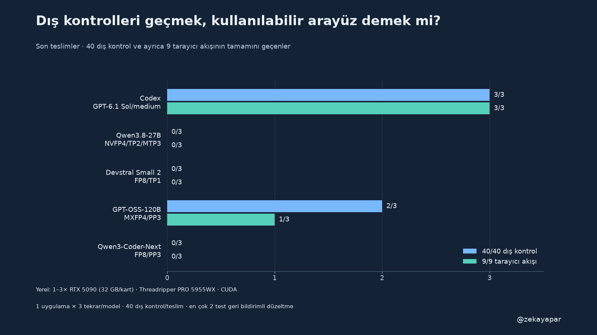

# Görev Masası

Görev ekleme, durum ve öncelik değiştirme, arama ve hesaplara göre veri ayrımı olan küçük bir web uygulaması. Python standart kütüphanesi, SQLite ve vanilla JavaScript kullanıyor.

Bu depoda aynı uygulamayı üreten beş modelin sürümleri bulunuyor: Codex GPT-6.1 Sol/medium ve dört yerel profil, üçer bağımsız tekrar. 15 son teslim, 39 ana model çağrısı. İlk teslimden sonra en fazla iki dış test geri bildirimiyle düzeltme. Ürün kodları ilgili modelin çıktısıdır; elle onarılmadı. Başarısız ve çalıştırılamayan örnekler de korunur.

[Yazı ve ayrıntılı değerlendirme](https://zekayapar.com/yazi/model-uygulama-teslimi) · [Hazırlık notları](https://zekayapar.com/yazi/model-uygulama-teslimi-notlari)

## Teslimler

`deliveries/<profil>/<tekrar>/` içinde modelin son `app.py`, `index.html` ve `README.md` dosyaları bulunur. Tekrar etiketleri 1800, 1801, 1802; bunlar üç ayrı uygulama görevi değil, aynı görevin bağımsız tekrarlarıdır. 45 dosyanın SHA256 değeri `FINAL-APPS-MANIFEST.json` ile eşleşir. Ham model cevapları ve özel çalışma arşivi bu depoya eklenmedi.

| Profil | Son dış kontrol tam geçişi | Tarayıcı 9/9 |
|---|---:|---:|
| Codex GPT-6.1 Sol/medium |3/3|3/3|
| Qwen3.8-27B NVFP4 TP2/MTP3 |0/3|0/3|
| Devstral Small 2 FP8 TP1 |0/3|0/3|
| GPT-OSS-120B MXFP4 PP3 |2/3|1/3|
| Qwen3-Coder-Next FP8 PP3 |0/3|0/3|

## Çalıştırma

Python 3.12 ve standart kütüphane kullanılır. Örnek, Codex ilk tekrar:

```bash
git clone https://github.com/zekayapar/gorev-masasi.git
cd gorev-masasi/deliveries/codex/1800
python3.12 app.py --port 18100 --db /tmp/zeka-gorev-masasi.sqlite
```

Arayüz: http://127.0.0.1:18100/ . Demo hesapları ve ayrıntılar ilgili teslimin README dosyasında. Demo uygulamaları internete açmayın: testler tam güvenlik incelemesi değildir; bazı teslimlerde oturum, HTML gösterimi ve başlatma hataları gözlendi. Örneklerin tümünün çalışması beklenmemeli.

## Dış kontrolü tekrar çalıştırma

Depo kökünde:

```bash
python3.12 harness/check-delivery.py deliveries/codex/1800 /tmp/zeka-delivery-check
```

`harness/evaluate.py` ve `bootstrap.py` özgün halleriyle korunur; taşınabilir sarmalayıcı yalnız Python yolunu mevcut yorumlayıcıyla değiştirir. Değerlendirici Linux native kaynak/erişim denetimi kullanır; OS güvenlik sandbox’ı değildir. Kontrolleri ayrı, geçici bir çalışma ortamında çalıştırın. Tarayıcı akışları bu komutun parçası değildir; gözlenen kayıtlar `BROWSER-RESULTS.json` içindedir. Demo localhost URL’leri tarihsel ölçüm adresleridir; canlı demo servisi değildir.

## Tekrar bazında son dış kontrol puanları

| Profil | Tekrar | Puan |
|---|---:|---:|
|Codex · GPT-6.1 Sol/medium|1800|40/40|
|Codex · GPT-6.1 Sol/medium|1801|40/40|
|Codex · GPT-6.1 Sol/medium|1802|40/40|
|Qwen3.8-27B · NVFP4/TP2/MTP3|1800|9/40|
|Qwen3.8-27B · NVFP4/TP2/MTP3|1801|9/40|
|Qwen3.8-27B · NVFP4/TP2/MTP3|1802|18/40|
|Devstral Small 2 · FP8/TP1|1800|0/40|
|Devstral Small 2 · FP8/TP1|1801|31/40|
|Devstral Small 2 · FP8/TP1|1802|25/40|
|GPT-OSS-120B · MXFP4/PP3|1800|40/40|
|GPT-OSS-120B · MXFP4/PP3|1801|40/40|
|GPT-OSS-120B · MXFP4/PP3|1802|8/40|
|Qwen3-Coder-Next · FP8/PP3|1800|35/40|
|Qwen3-Coder-Next · FP8/PP3|1801|24/40|
|Qwen3-Coder-Next · FP8/PP3|1802|9/40|

Görev `BRIEF.md`, ortak yönlendirme `SYSTEM.txt`, yöntem `PROTOCOL.md`, sonuçlar `RESULTS.md`, çağrı ölçümleri `MEASUREMENTS.csv` içinde. Yerel profiller farklı quantization/paralellik/düşünme ayarları kullanır. Bu tek görevin sonucu genel model veya kodlama ajanı sıralaması değildir.


